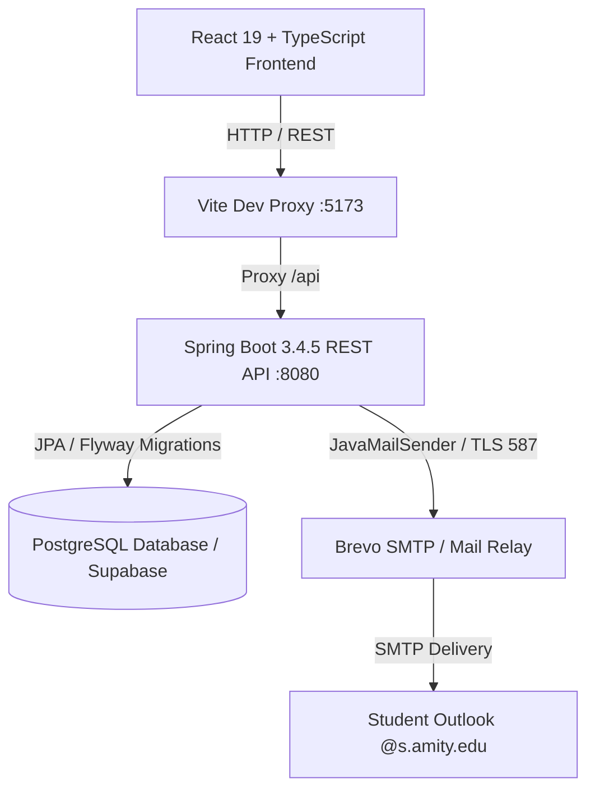

# 🏛️ Campus Pulse

> **Next-Generation Campus Incident Dispatch & Facility Management Platform**  
> *Engineered for Amity University. Report issues in under 30 seconds via scannable QR placards, track automated SLA countdowns, and streamline campus-wide maintenance resolution.*

[](https://spring.io/projects/spring-boot)
[](https://react.dev/)
[](https://www.typescriptlang.org/)
[](https://vitejs.dev/)
[](https://supabase.com/)
[](https://opensource.org/licenses/MIT)

---

## 🌟 Executive Overview

**Campus Pulse** is an enterprise-grade university operations and incident dispatch platform designed to modernize campus living, maintenance, and facility management across university blocks, lecture halls, computer laboratories, hostels, and sports facilities.

It provides a transparent, collaborative communication loop between students, faculty, facility dispatch technicians, and university administration with real-time SLA tracking, automated OTP authentication, community upvoting, and single-click printable QR doorplate placards.

---

## ✨ Key System Features

### 🎓 1. Verified Amity Authentication & Passwordless OTP
- **Domain-Enforced Registration:**
  - Students: Strict validation for `@s.amity.edu` email domains and enrollment numbers (`A...`).
  - Staff / Faculty: Dedicated registration for official `@amity.edu` addresses.
- **Enterprise OTP Delivery Engine:**
  - Integrated with **Brevo (Sendinblue)** and **Gmail SMTP** relays.
  - Sends high-priority verification emails with official university branding directly to Microsoft 365 Outlook inboxes.
  - Built-in rate limiting, 10-minute expiry, and database persistence.
  - **Dev Testing Mode:** Built-in auto-fill helper for instant offline testing without requiring an email server.

### 📱 2. High-Resolution QR Doorplate Placards & PDF Generation
- **Dynamic Scannable QR Codes:** Every single classroom, computer lab, seminar hall, and facility across Blocks A through J has a dedicated scannable QR token.
- **Instant Printable A4 Doorplates:** Single-click download of official Amity university doorplate placards in `.pdf` format powered by `jspdf` and `qrcode`.
- **Smart QR Auto-Fill:** Scanning a room placard via any mobile camera automatically routes the student to the report form with Block, Floor, and Room pre-selected.

### 🧭 3. 4-Way Campus Hub Directory & Smart Search
- Comprehensive campus facility directory with instant multi-facet filtering:
  - **Block Filter:** Blocks A through J.
  - **Floor Filter:** Ground Floor, 1st Floor, 2nd Floor, 3rd Floor, 4th Floor.
  - **Facility Type Filter:** Classrooms, Computer Labs, Washrooms, Auditoriums, Faculty Cabins, Cafeteria.
  - **Live Search Query:** Instant fuzzy search across room numbers, faculty names, and lab names.

### ⏱️ 4. Automated SLA Deadlines & Real-Time Tracking
- Every reported issue is categorized with automated Service Level Agreement (SLA) timers:
  - `CRITICAL`: 2 Hours (e.g., electrical hazards, elevator failures)
  - `HIGH`: 6 Hours (e.g., lab AC failure, projector malfunction during lectures)
  - `MEDIUM`: 24 Hours (e.g., plumbing, door locks)
  - `LOW`: 48 Hours (e.g., furniture, aesthetic repairs)
- Dynamic visual countdown timers with breach alerts for administration.

### 👥 5. Dedicated Persona Workspaces
- **Student Portal:** Browse the live campus feed, report issues, upvote community tickets to prevent duplicates, and rate completed resolutions.
- **Staff Dispatch Queue:** Department-specific operational dashboard (IT, Housekeeping, Electrical, Civil) to claim tickets, update progress (`ASSIGNED`, `IN_PROGRESS`, `RESOLVED`), and attach resolution notes.
- **Admin Command Center:** University-wide analytics, SLA breach audits, department efficiency metrics, and campus location registry.

---

## 🏗️ System Architecture



---

## 🗂️ Project Structure

```
Campus Pulse/
├── backend/                              # Spring Boot 3 REST API (Java 21/25)
│   ├── src/main/java/com/campuspulse/
│   │   ├── api/                          # REST Controllers & DTOs
│   │   ├── config/                       # Security, CORS, OpenAPI, Data Seeders
│   │   ├── domain/                       # JPA Entities (User, Issue, Location, Otp, SLA)
│   │   ├── exception/                    # Global Exception Handlers
│   │   ├── repository/                   # Spring Data JPA Repositories
│   │   ├── security/                     # UserPrincipal & Security Context
│   │   └── service/                      # Business Logic (Auth, Issue, OTP, Mail)
│   ├── src/main/resources/
│   │   ├── db/migration/                 # Flyway SQL Migrations (V1 to V7)
│   │   ├── application.properties        # Core Application Properties
│   │   └── application-supabase.properties # Supabase Cloud Profile
│   ├── .env.example                      # Environment variables template
│   └── pom.xml                           # Maven dependencies
├── frontend/                             # React 19 + TypeScript Frontend
│   ├── src/
│   │   ├── components/                   # Modular UI Components
│   │   │   ├── AdminDashboard.tsx        # University Analytics & SLA Audits
│   │   │   ├── AuthModal.tsx             # Amity SSO & 6-Digit OTP Modal
│   │   │   ├── CampusFeed.tsx            # Live Campus Ticket Feed & Filters
│   │   │   ├── CampusHub.tsx             # 4-Way Directory & QR Placard Center
│   │   │   ├── IssueDetailModal.tsx      # Comprehensive Issue Inspection & Upvoting
│   │   │   ├── LocationSelector.tsx      # Interactive Campus Selector
│   │   │   ├── QrPlacardsModal.tsx       # Live QR Inspector & A4 PDF Generator
│   │   │   ├── ReportIssue.tsx           # Quick 30-Second Issue Submission
│   │   │   ├── Sidebar.tsx               # Navigation & Role Selector
│   │   │   ├── StaffQueue.tsx            # Technician Dispatch & Ticket Triage
│   │   │   └── Topbar.tsx                # Status Banner & Notifications
│   │   ├── data/locationCatalog.ts       # Structured University Campus Catalog
│   │   ├── utils/qrPdfGenerator.ts       # jsPDF & QRCode Placard Generator Engine
│   │   ├── types.ts                      # Unified TypeScript Definitions
│   │   ├── App.tsx                       # Master Application Root
│   │   └── index.css                     # Global Design System & Variables
│   ├── package.json                      # Frontend dependencies
│   └── vite.config.ts                    # Vite config with API proxy
├── docs/                                 # Technical Specifications & SRS
├── .env.example                          # Root environment template
└── README.md                             # Project Documentation
```

---

## 🚀 Getting Started

### 📋 Prerequisites
- **Java JDK 21 or 25** (OpenJDK or Eclipse Temurin)
- **Node.js 18+** & `npm`
- **Git**

---

### 1. Clone & Setup Configuration
```bash
git clone https://github.com/Gohan208x/Campus-Pulse.git
cd Campus-Pulse
```

Create your `backend/.env` file:
```bash
# Windows (PowerShell)
Copy-Item backend\.env.example backend\.env

# Linux / macOS
cp backend/.env.example backend/.env
```

---

### 2. Configure Database & Email OTP

Edit `backend/.env` with your settings:

```properties
SPRING_PROFILES_ACTIVE=supabase

# ─── Supabase PostgreSQL Database ─────────────────────────────────────────────
SUPABASE_DB_URL=jdbc:postgresql://aws-0-ap-south-1.pooler.supabase.com:5432/postgres?sslmode=require
SUPABASE_DB_USER=postgres.your_project_id
SUPABASE_DB_PASSWORD=YourDatabasePassword

# ─── Brevo SMTP Configuration (Recommended - Free) ───────────────────────────
SPRING_MAIL_HOST=smtp-relay.brevo.com
SPRING_MAIL_PORT=587
SPRING_MAIL_USERNAME=your_brevo_smtp_login
SPRING_MAIL_PASSWORD=your_brevo_smtp_key

APP_MAIL_FROM=your_verified_brevo_email@gmail.com
APP_MAIL_FROM_NAME=Amity University Dispatch Portal
```

> 💡 **Tip:** If you do not configure an external SMTP provider, the application automatically runs in **Dev Mode**: OTPs are printed directly in the backend terminal console, and an **Auto-Fill** button appears in the UI.

---

### 3. Run the Backend

```bash
cd backend
./mvnw spring-boot:run
```
*(On Windows Command Prompt: `mvnw.cmd spring-boot:run`)*

- Backend API boots on: `http://localhost:8080`
- Interactive Swagger UI: `http://localhost:8080/swagger-ui.html`
- Health Endpoint: `http://localhost:8080/api/v1/health`

---

### 4. Run the Frontend

In a second terminal:
```bash
cd frontend
npm install
npm run dev
```

- Web Application runs on: `http://localhost:5173`

---

## 🧪 Default Test Personas

The system automatically initializes with pre-seeded demo accounts across university roles:

| Role | Email | Campus | Description |
|---|---|---|---|
| **Student** | `student1@s.amity.edu` | Noida | Undergraduate Student |
| **Student** | `student2@s.amity.edu` | Noida | Postgraduate Student |
| **Staff (IT)** | `staff.it@amity.edu` | Noida | IT Systems Engineer |
| **Staff (Housekeeping)** | `staff.housekeeping@amity.edu` | Noida | Facilities Specialist |
| **Staff (Electrical)** | `staff.electrical@amity.edu` | Noida | Electrical Maintenance |
| **Admin** | `admin@amity.edu` | Noida | Campus Operations Director |

*(You can also register your personal `@s.amity.edu` email using the passwordless OTP registration flow).*

---

## 📑 Interactive API Endpoints (Swagger / OpenAPI)

| Category | Method | Endpoint | Description |
|---|---|---|---|
| **Health** | `GET` | `/api/v1/health` | Service health & build version |
| **Auth** | `POST` | `/api/v1/auth/signup/send-otp` | Request 6-digit registration OTP |
| **Auth** | `POST` | `/api/v1/auth/signup/verify` | Complete student / staff signup |
| **Auth** | `POST` | `/api/v1/auth/login/send-otp` | Request passwordless sign-in OTP |
| **Auth** | `POST` | `/api/v1/auth/login/verify` | Verify OTP and create session |
| **Auth** | `POST` | `/api/v1/auth/logout` | Invalidate authenticated session |
| **Issues** | `GET` | `/api/v1/issues` | Fetch feed with filtering & pagination |
| **Issues** | `POST` | `/api/v1/issues` | Report a new campus issue |
| **Issues** | `POST` | `/api/v1/issues/{id}/upvote` | Upvote an existing issue |
| **Staff** | `GET` | `/api/v1/staff/queue` | Technician issue resolution queue |
| **Staff** | `PATCH` | `/api/v1/staff/issues/{id}/status` | Update resolution status & notes |
| **Admin** | `GET` | `/api/v1/admin/analytics` | University SLA metrics & audits |

Full Swagger documentation is available at `http://localhost:8080/swagger-ui.html`.

---

## 🔒 Security & Data Protection

1. **Credentials Isolation:** Secret keys, SMTP passwords, and database credentials are kept strictly inside `.env` (which is git-ignored and never committed to source control).
2. **Session Security:** Standard HTTP-only session cookies with CSRF defense, role-based method security, and rate-limited auth endpoints.
3. **Audit Trails:** Status transitions and issue assignments maintain complete history records (`IssueStatusHistory`) for administrative transparency.

---

## 📜 License

This project is licensed under the [MIT License](LICENSE).
